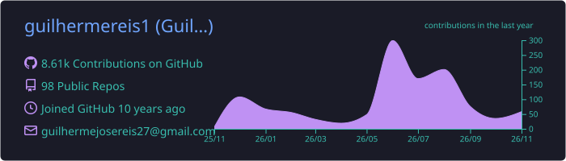
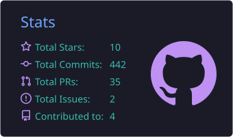
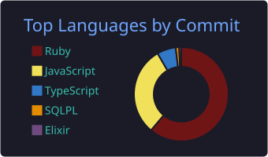

# Hi, I'm Guilherme Reis 👋

**Software Engineer @ Devlabs · Full Stack · Backend & Cloud**

Building software professionally since 2014 — APIs, financial systems, data-heavy frontends and the infrastructure behind them.

---

### ⚡ At a glance

- **Rails specialist** — APIs, admin panels, background jobs (Sidekiq, Bull), WebSockets, multi-tenant apps
- **Full stack** — React, Next.js, Redux and React Native for web dashboards and mobile apps
- **Strong on testing** — RSpec, TDD, unit, integration, E2E, acceptance and performance tests
- **Ships to production** — Docker, Kubernetes, AWS (S3, Lambda), CI/CD, Fly.io, Dokku
- **End-to-end ownership** — I gather requirements, design the solution, build it and put it online
- **Clean code** — SOLID, DDD, design patterns, Agile/Scrum
- **Remote-ready** — worked with teams from Paraguay, Portugal and Spain

### 🔭 What I'm working on

- Multi-tenant **financial management systems** with Rails and React/Next.js dashboards
- **Database integrations** with PostgreSQL, Oracle and legacy systems
- **Brazilian market software** — fiscal integrations (NFC-e) and POS systems
- **AI-powered features** — LLM integrations, agents, OpenRouter

### 🌱 Currently exploring

Rust, Go and Elixir for systems work · Kubernetes for container orchestration

---

### 💼 Experience

**Devlabs** — Software Engineer · *Jul 2025 – Present* · Goiânia, BR
> Full stack and infrastructure work across client projects: Rails, Next.js, PostgreSQL/Oracle, cloud deployments and AI integrations.

**Apolus Tecnologia** — Ruby on Rails Developer · *Sep 2022 – Jan 2024* · São Paulo, BR
> Maintained and tested the API of a school management system running on Docker. Built a Node.js API for biometric student access, using Bull queues and Redis. Agile/Scrum.

**Nobordist** — Full Stack Developer · *Feb 2022 – Sep 2022*
> International parcel delivery and tracking platform. Rails API built with TDD, React frontend.

**Nuvem Tecnologia** — Frontend Developer · *Jan 2021 – Jan 2022*
> Financial market application. Rendered large volumes of real-time data with React, Hooks and Redux.

**Amazonia Sistemas** — Full Stack Developer · *Jan 2019 – Dec 2020*
> Built a Trello-like Kanban product with Rails, React, WebSockets and React Native.

**TechMirror Lab** — Backend Ruby Developer · *Mar 2014 – Nov 2018*
> Rails systems with TDD/RSpec, microservices, AWS (Lambda, S3) and payment gateways (Iugu, PagSeguro). Built a health plan management system with a full approval pipeline for new members.

<b>Freelance projects (2019 – 2020)</b>

 

| Project | What it does | Stack |
|---|---|---|
| **BillsToPay** | Accounts payable and receivable | Rails, PostgreSQL, Sidekiq, WebSockets |
| **Grows Capital** | Investment tracking: investors, amounts and daily returns | Rails, Sidekiq, WebSockets, PostgreSQL |
| **Digital Catalog** | PWA catalog of local businesses and products | React PWA, Redux, Rails API + admin, S3 |
| **NPS App** | Net Promoter Score mobile app with web dashboard | React Native, React, Rails API, PostgreSQL |
| **Economize Ainda Mais** | Price comparison across regional supermarkets | Rails, Docker, DDD, REST API, PostgreSQL |

---

### 🛠️ Stack

**Languages**

**Frameworks & Backend**

&nbsp;+ React Native · Sidekiq · Bull

**Databases**

&nbsp;+ Oracle

**Cloud & DevOps**

&nbsp;+ Fly.io · Dokku

**Testing**

&nbsp;+ RSpec

---

### 🎓 Education & Languages

- **B.Sc. Systems Analysis and Development** — PUC Paraná · *2020 – 2024*
- **English** — full professional · General English at EC Cambridge, UK (2024)
- **Spanish** — limited working
- **Portuguese** — native

---

### 📊 GitHub Stats

---

<picture>
  <source media="(prefers-color-scheme: dark)" srcset="./profile-3d-contrib/profile-night-rainbow.svg"/>
  <source media="(prefers-color-scheme: light)" srcset="./profile-3d-contrib/profile-south-season-animate.svg"/>
  
</picture>

